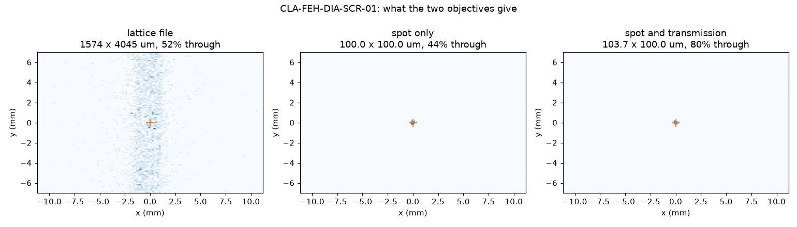
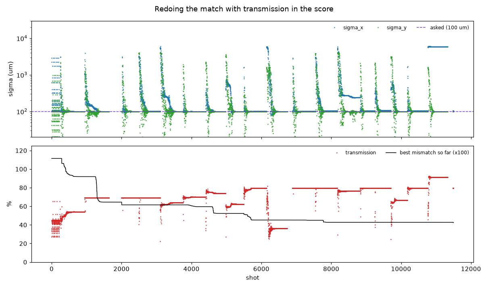
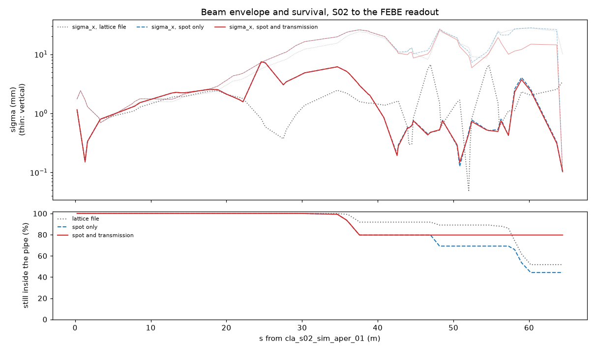
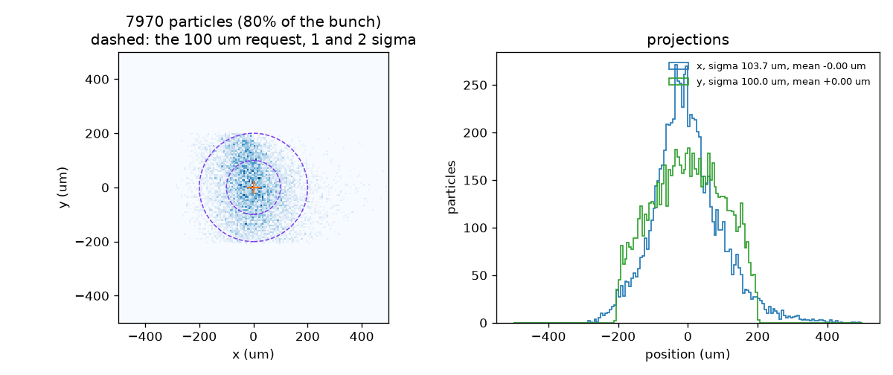
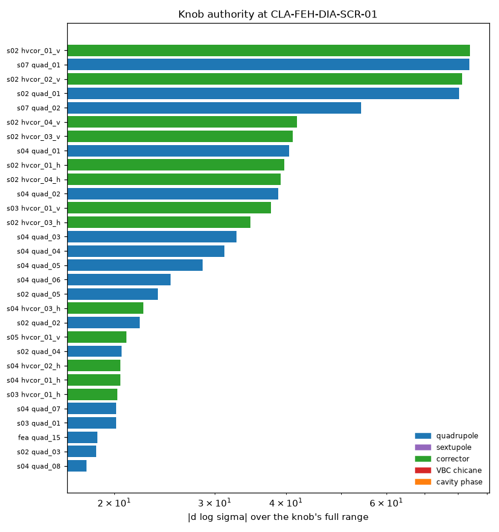
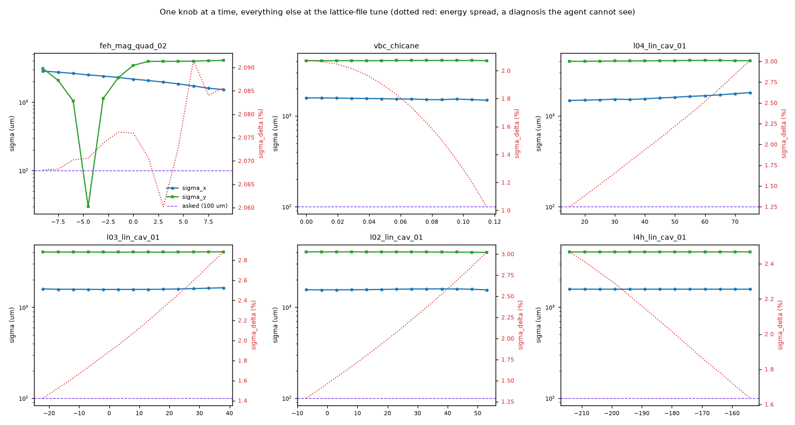
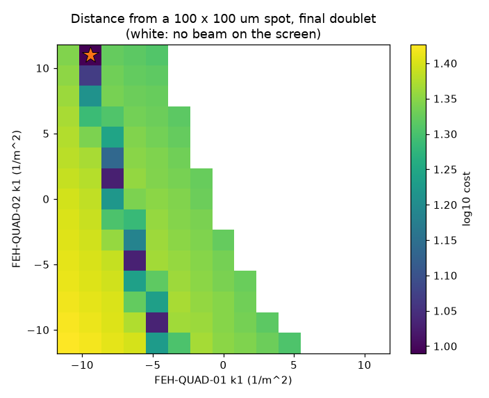
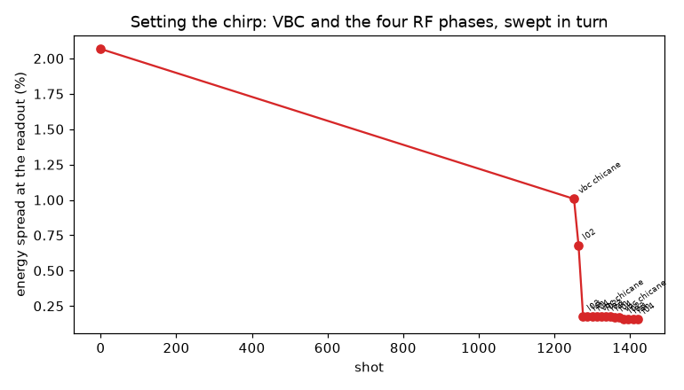
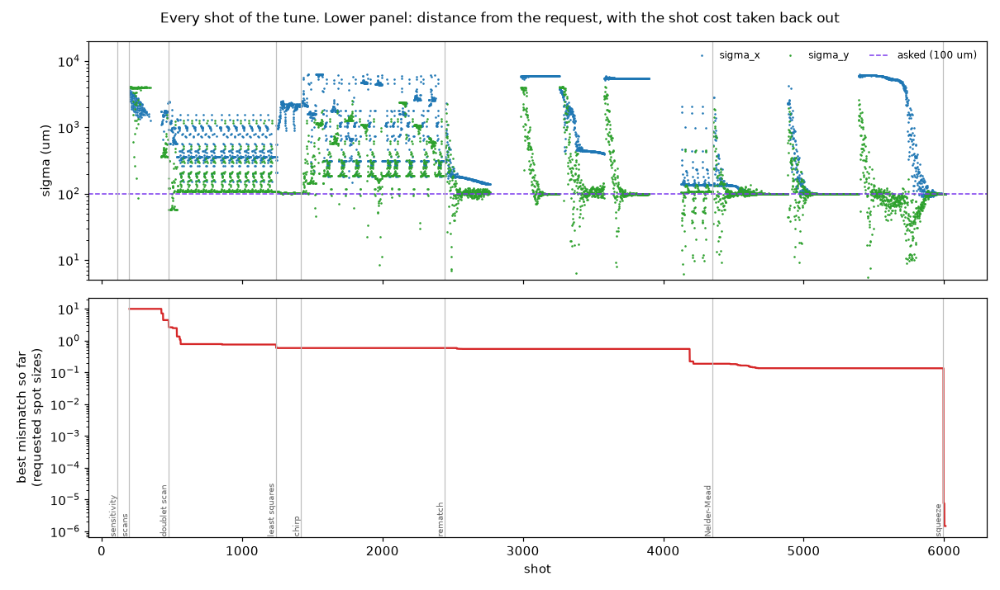
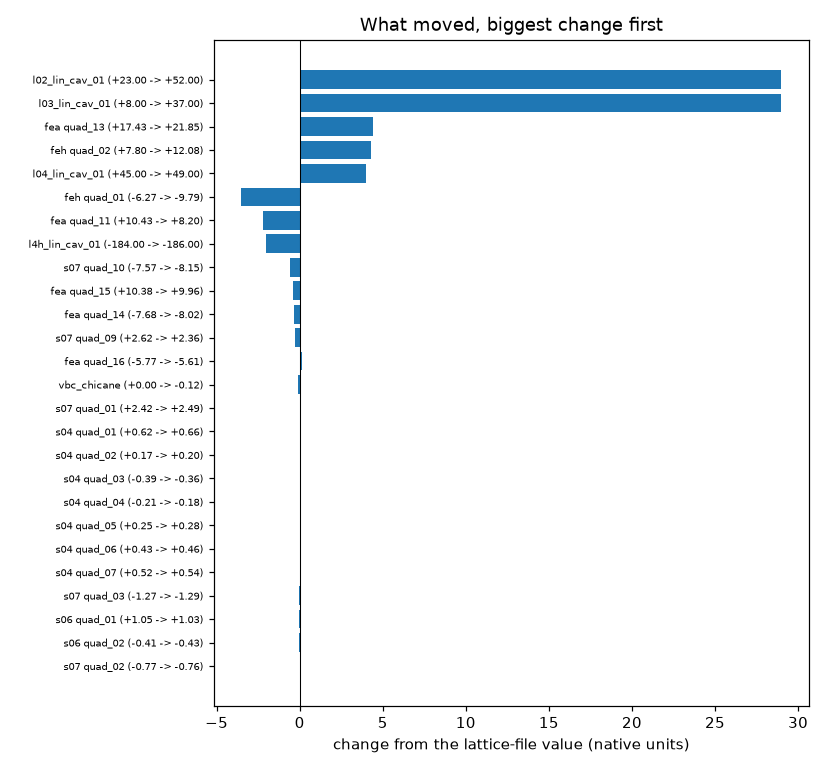

# A 100 µm spot at the FEBE readout

Asked for a centred 100 × 100 µm beam at `CLA-FEH-DIA-SCR-01` and tuned the nominal
model to it with every knob the environment offers.

| | lattice file | spot only | **spot and transmission** |
|---|---|---|---|
| σx | 1574 µm | 100.0 µm | **103.7 µm** |
| σy | 4045 µm | 100.0 µm | **100.0 µm** |
| centroid | (−0.31, −0.07) mm | (0.000, −0.000) µm | **(−0.000, 0.000) µm** |
| beam delivered | 51.7 % | 44.3 % | **79.7 %** |
| energy spread at the readout | 2.07 % | 0.156 % | 0.156 % |
| `score.py` mismatch | — | 1.115 | **0.424** |

The first pass hit the spot exactly and nothing in the objective asked it to keep the
beam, so it threw away more than half of it — worse than the lattice file. Adding a
transmission term to `score.py` and redoing the match gave up 3.7 % of σx and bought
back 35 points of transmission.

The settings are in [`reference_tune_febe_100um.json`](reference_tune_febe_100um.json),
in the same shape as `data/clara/lattice_data/reference_tune.json`, so
`score.apply_tune(segment, json["elements"])` loads it. Reapplying it to a clean
segment reproduces the numbers above exactly.

## Scoring beam that never arrives

`score.per_case_scores` now charges `TRANSMISSION_WEIGHT × (1 − survival)`, with the
weight at 2.0, so delivering half the bunch costs one spot size — the same as missing
the requested size by 100 %. Without it, a tight spot bought by scraping the rest of
the beam off the pipe scored perfectly. `SimEnv` mirrors the same term, verified to
agree with `score.py` to 1 × 10⁻⁹ on the same case.

The lower panel is the point. The transmission-aware tune takes a single 20 % hit at
the S07 aperture (s = 37 m) and then holds flat the whole way through the FEA arc.
The spot-only tune and the lattice-file optics both keep bleeding through the arc,
down to 44 % and 52 %.

## The spot

The environment's own 128 × 128 observation is 175 µm per pixel, so a 100 µm sigma is
sub-pixel there. Resolved from the particles:

## How it went

Everything is an `env.step`, so the shot counts are honest.

### 1. What has authority (113 shots)

Probed all 111 knobs. Ranking by effect per probe step just ranks the probe steps I
chose, so the useful ranking is by what each can do over its whole range:

Quadrupoles dominate. Correctors score highly only because moving the beam off the
chip changes the measured size — an artefact of the metric. The phases and chicane
score near zero *here*, which turned out to be misleading.

### 2. One knob at a time (197 shots)

At the lattice-file tune the dispersion is already closed, so the size is pure
betatron mismatch and the chirp knobs barely move it — σx spans 1476–1802 µm across
the entire L04 phase range. The dotted red trace is the energy spread, which they
move a great deal (1.03–3.03 %). The chirp knobs do nothing until the optics is tight
enough for chromaticity to matter.

A feasibility check here was discouraging: geometric emittance at the readout was
27.5 nm horizontally but **4337 nm vertically**, and only 233 nm in a 0.2 % energy
slice — 95 % of it chromatic filamentation of a badly mismatched beam rather than
emittance the beam carries.

### 3. A start, and a least-squares match (475 → 1240 shots)

A 15 × 15 scan of the final doublet, then Levenberg–Marquardt on 45 knobs against
`log(σ/100 µm)`. Reached 357 × 107 µm and stuck.

### 4. Set the chirp (1420 shots)

Three sweeps of the chicane and the four RF phases for minimum energy spread at the
readout: **2.07 % → 0.156 %**. The chicane went to its −115.6 mrad limit.

This is the one step an agent could not do from its observation — energy spread is
not something a screen measures, and it was read out of the model. Legitimate for
designing a reference tune, but it does not transfer to the machine as written.

### 5. Search, not gradient (1240 → 6010 shots)

Least squares stuck again at 315 × 189 µm after the chirp change. With a handful of
residuals against dozens of knobs the landscape is full of flat local minima and
damped least-norm steps sit in them — this happened three separate times. Multi-start
Nelder–Mead over the final-focus quadrupoles found 139 × 104 µm from its first start,
and a tight second pass closed the rest to exactly 100 × 100 µm.

### 6. Redo, with transmission (11 500 further shots)

Least squares stuck immediately again, improving nothing in 18 iterations. Grouped
Nelder–Mead over the final focus, then the arc entrance, then S07, walked
transmission 44.3 → 69.2 → 74.1 → 79.7 % while holding the spot. A second round found
nothing more.

### Steering

A 4 × 2 response matrix on the FEH and FEA correctors, solved and applied, interleaved
with the matching. Never the hard part: it is linear and one solve puts the centroid
within a nanometre.

## Caveats

- **17 500 shots in total.** Irrelevant for an offline reference tune, ruinous as a
  benchmark entry — `score.py` would price it above the mismatch it achieves.
- **The chirp step used the model**, as described in stage 4.
- **One machine.** Zero variation, zero misalignment, no jitter, no ripple. The tune
  has not been tested against a jittered beam or a survey error, and tight optics is
  what survey error hurts most.
- **Transmission is still 20 % short**, all of it lost at the S07 aperture at
  s = 37 m. Nothing downstream can recover it; it would need the S02–S06 optics,
  which this tune left alone.
- **`TRANSMISSION_WEIGHT = 2.0` is a judgement call**, not a measured trade-off. It
  makes half a bunch worth one spot size. Change it in `score.py` if that is the
  wrong exchange rate.
- **The 4HC phase barely matters** — it moved 2 degrees.

## Files

| file | what it is |
|---|---|
| `tune_febe_100um.py` | the run, as one script, in the stages it was driven |
| `reference_tune_febe_100um.json` | the resulting settings, in `score.apply_tune` format |
| `sensitivity.json` | every knob's measured effect on σx, σy, µx, µy |
| `01_*` … `10_*` | the plots above |
